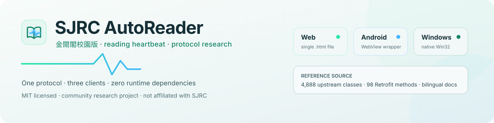
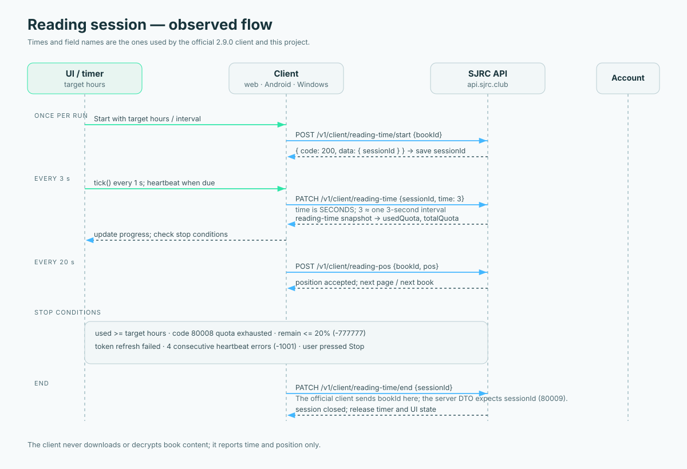

<div align="center">



# SJRC AutoReader

**A protocol-faithful reading-time client for 金閱閣校園版 (SJRC 2.9.0)**

One behavioural contract, three independent builds, zero runtime dependencies.
The repository also carries the decompiled reference source used to recover the
protocol, so every network claim can be audited.

<br>


**English** · [繁體中文](README.zh.md)

[Download](#-download) · [How it works](#-how-it-works) · [Documentation](#-documentation) · [Build](#-build-from-source) · [FAQ](#-faq) · [Contributing](#-contributing)

</div>

---

> [!WARNING]
> **Research and personal study only.** Automating reading time may violate the
> platform's terms of service, your school's rules, or both. Accounts can be
> limited or closed. This project is not affiliated with, endorsed by, or
> supported by SJRC. Read [Legal and acceptable use](docs/en/legal.md) before
> running it. You are responsible for how you use it.

> [!NOTE]
> This is a **client-side interoperability project**, not a book downloader. It
> reports reading time and page position to the API. It does **not** download
> books, request DRM keys, decrypt content, collect credentials, or operate a
> backend. The decompiled source describes the content-protection layer without
> shipping any key material.

---

## 📥 Download

Each build is one file. No installer, no runtime, no auto-updater.

<table>
<tr>
<td align="center" width="33%">

### 🌐 Web

[**Download `SJRC_AutoReader.html`**](web/SJRC_AutoReader.html?raw=1)

<sub>86,464 B · single file</sub>

<sub>`d42615d827eeeb21…`</sub>

</td>
<td align="center" width="33%">

### 📱 Android

[**Download `SJRC-AutoRead.apk`**](phone/SJRC-AutoRead.apk?raw=1)

<sub>53,784 B · minSdk 23</sub>

<sub>`a8959831023403cc…`</sub>

</td>
<td align="center" width="33%">

### 💻 Windows

[**Download `SJRC_AutoReader.exe`**](pc/SJRC_AutoReader.exe?raw=1)

<sub>991,237 B · static x64</sub>

<sub>`125d1ff535754b2c…`</sub>

</td>
</tr>
</table>

Verify every file against [`SHA256SUMS`](SHA256SUMS):

```bash
sha256sum -c SHA256SUMS          # Linux
shasum -a 256 -c SHA256SUMS      # macOS
```

The short hashes above are prefixes; the file contains the full SHA-256. If a
download does not match, stop and re-download from this repository. See
[Installation](docs/en/installation.md#verify-the-download) for platform-specific
instructions and uninstall steps.

---

## ⚡ Quick start

### Web · audit-friendly

```bash
cd web
python3 -m http.server 8080
# open http://localhost:8080/SJRC_AutoReader.html
```

The page must be served over HTTP. `file://` has a `null` origin, which breaks
Google Identity Services. Sign in with Google, keep the demo checkbox off, and
press **Start**. The browser tab must stay alive.

**Google origin:** register `http://localhost:8080` in
[Google Cloud Console](https://console.cloud.google.com/apis/credentials) →
your OAuth client → **Authorized JavaScript origins**. Scheme, host, port, and
absence of a trailing slash all matter.

### Android · phone

1. Copy `phone/SJRC-AutoRead.apk` to the device.
2. Allow “install unknown apps” for the file manager.
3. Install and open; sign in with **email + password**.
4. Press **Start** and keep the app in the foreground as much as possible.

The wrapper is `club.sjrc.autoread` (`minSdk 23`, `targetSdk 33`), not the
official `club.sjrc.app`. Google sign-in is intentionally absent: Google blocks
OAuth in embedded WebViews. See
[Android installation](docs/en/installation.md#android).

### Windows · native

Double-click `pc/SJRC_AutoReader.exe`. It is unsigned, so SmartScreen may warn;
verify the hash first, then choose **Run anyway**.

Sign in by opening the temporary local Google helper, or paste an access token
copied from a browser session. Settings and tokens live under
`HKCU\Software\SJRC\AutoReader`. See
[Windows installation](docs/en/installation.md#windows).

### Sign-in matrix

| Method | Web | Android | Windows |
|---|:---:|:---:|:---:|
| Google account | ✅ | ❌ | ✅ local helper |
| Email + password | ❌ | ✅ | ❌ |
| Verification code | ✅ | ✅ | ✅ |
| Paste access token | ❌ | ❌ | ✅ |

The web build is Google-only. The Android wrapper is email/password-only. The
Windows build supports the local Google helper and manual token import. All three
exchange a verification code when the server returns a `ticket` instead of
tokens. If your account has no password, set one in the official app:
**我的 → 密碼 → 修改**.

---

## ✨ What it does

| | Behaviour | Detail |
|---|---|---|
| 💓 | **3-second heartbeat** | Mirrors the official client: `setCountDownInterval(3000)` and `time: 3` **seconds** |
| 📖 | **Reading session** | `start` creates a `sessionId`; every heartbeat and the final `end` use it |
| 📄 | **Page turns** | Default 20 s; each turn reports `POST /v1/client/reading-pos` |
| 📚 | **Auto-advance** | Finishes a book, then chooses a random next book from the shelf/homepage |
| 🎯 | **Target stop** | Stops when accumulated time reaches the target hours you set |
| 🛑 | **Safe stop** | Manual stop, quota exhaustion (`80008`), ≤20% remaining (`-777777`), or four consecutive heartbeat errors (`-1001`) |
| 🧹 | **Session cleanup** | Sends `PATCH /reading-time/end {sessionId}` on stop/close |
| 🔐 | **Local credentials** | Tokens stay in browser storage, WebView storage, or the current user's registry hive |
| 📦 | **No dependencies** | Vanilla JS, a WebView shell, and statically linked C++ |
| 🧪 | **Demo mode** | Exercises the UI and counters without sending a request |

### What it explicitly does not do

- ❌ Download book files, images, or EPUB content
- ❌ Request `booksKey`, decrypt DRM, or store key material
- ❌ Use a backend, proxy, relay, analytics SDK, or crash reporter
- ❌ Bypass authentication, quota, or account restrictions
- ❌ Guarantee that automation is permitted by your institution

---

## 🔁 How it works

The three clients share no code, but they implement the same observed contract.
The full sequence is in [Architecture](docs/en/architecture.md#session-state-machine)
and [API reference](docs/en/api.md).



```text
sign in ──► accessToken (+ refreshToken)
              │
              ▼
POST /v1/client/reading-time/start { bookId } ──► { sessionId, totalQuota, usedQuota }
              │
              ├── every 3 s:   PATCH /v1/client/reading-time { sessionId, time: 3 }
              ├── every 20 s:  POST  /v1/client/reading-pos  { bookId, pos }
              └── at stop:     PATCH /v1/client/reading-time/end { sessionId }
```

Things that are easy to get wrong, and that this repository documents explicitly:

| Pitfall | Correct behaviour |
|---|---|
| Sending `time` in milliseconds | Send **seconds**. `3` means three seconds; `28800` quota means 8 hours. |
| Sending `bookId` to `end` | Send **`sessionId`**. The official client sends `bookId` and gets `80009`. |
| Omitting `x-auth-schema` | Send `CLIENT` for authenticated routes, `PUBLIC` for login/refresh. |
| Attaching a Bearer token everywhere | Attach it only for `CLIENT` with a non-empty token. |
| Using verification code alone | The code needs the `ticket` from `pre-login`; the ticket is one-shot. |
| Google inside Android WebView | Blocked by Google (`disallowed_useragent`); use email/password. |

The shared headers are `version: 2.9.0`, `x-current-platform: android`,
`x-current-locale: zh-HK`, `x-auth-schema`, and `authorization`. The API base is
`https://api.sjrc.club/`; success is `code == 200 || code == 201`, not merely
HTTP 200.

---

## 🗂 Repository layout

```text
SJRC-AutoReader-Repo/
├── web/
│   ├── SJRC_AutoReader.html      # complete single-file web app
│   └── src/README.md             # structure walkthrough
├── phone/
│   ├── SJRC_AutoRead.apk         # signed WebView wrapper (club.sjrc.autoread)
│   └── src/
│       ├── AndroidManifest.xml
│       ├── index.html            # embedded page: email/password + __appPause
│       ├── *.smali               # 6 official-client protocol excerpts
│       └── README.md
├── pc/
│   ├── SJRC_AutoReader.exe       # native Win32/WinHTTP, statically linked
│   └── src/
│       ├── main.cpp              # entire Windows client
│       ├── build.bat · app.rc · app.ico
│       └── README.md
├── sjrc-source/
│   ├── smali/                    # 4,888 classes, cryptographic constants redacted
│   ├── AndroidManifest.xml
│   ├── net_endpoints.json        # 98 extracted Retrofit methods
│   └── README.md
├── data/                         # clean endpoint tables + source statistics
├── examples/                     # .http request recipes (no credentials)
├── docs/
│   ├── en/ · zh/                 # 17 bilingual pages
│   ├── assets/                   # banner, logo, architecture diagrams
│   └── screenshots/
├── scripts/                      # checker, packager, local server
├── .github/                      # CI, release workflow, issue forms
├── CODE-OVERVIEW.md              # the whole project in one narrative document
├── README.md · README.zh.md
├── CONTRIBUTING.md · SECURITY.md · SUPPORT.md · GOVERNANCE.md
├── CODE_OF_CONDUCT.md · CHANGELOG.md · ROADMAP.md
├── AUTHORS.md · NOTICE.md · CITATION.cff
└── LICENSE                        # MIT, original work only
```

A task-oriented “I want to change X” index is in
[Code map](docs/en/code-map.md). The single-file narrative summary is
[`CODE-OVERVIEW.md`](CODE-OVERVIEW.md) (Traditional Chinese, with an English
abstract).

---

## 📚 Documentation

Every page exists in English and Traditional Chinese with the same structure.
Start with the path that matches your goal.

### Run it

| Page | English | 中文 | What it answers |
|---|---|---|---|
| 1 | [Getting started](docs/en/getting-started.md) | [快速開始](docs/zh/getting-started.md) | Is it safe? First run in five minutes |
| 2 | [Installation](docs/en/installation.md) | [安裝](docs/zh/installation.md) | Per-platform install, checksums, uninstall |
| 3 | [Configuration](docs/en/configuration.md) | [設定](docs/zh/configuration.md) | Every field, default, range, storage key |
| 4 | [Usage](docs/en/usage.md) | [使用](docs/zh/usage.md) | Full run loop, logs, stop conditions, good habits |

### Understand it

| Page | English | 中文 | What it answers |
|---|---|---|---|
| 5 | [Architecture](docs/en/architecture.md) | [架構](docs/zh/architecture.md) | Components, state machine, data flow, design choices |
| 6 | [API reference](docs/en/api.md) | [API 參考](docs/zh/api.md) | Headers, endpoints, DTOs, units, auth, error codes |
| 7 | [Code map](docs/en/code-map.md) | [程式碼地圖](docs/zh/code-map.md) | Where each behaviour lives, line by line |
| 8 | [Reverse engineering](docs/en/reverse-engineering.md) | [逆向分析](docs/zh/reverse-engineering.md) | Method, evidence, heartbeat machine, limits |
| 9 | [Glossary](docs/en/glossary.md) | [名詞解釋](docs/zh/glossary.md) | Heartbeat, session, ticket, quota, smali, DTO |

### Build, test, ship

| Page | English | 中文 | What it answers |
|---|---|---|---|
| 10 | [Building](docs/en/building.md) | [建置](docs/zh/building.md) | Rebuild web, APK, and EXE |
| 11 | [Testing](docs/en/testing.md) | [測試](docs/zh/testing.md) | Static checks, mock tests, manual matrix |
| 12 | [Release process](docs/en/release.md) | [發行流程](docs/zh/release.md) | Versioning, packaging, checksums, tags |

### Trust and boundaries

| Page | English | 中文 | What it answers |
|---|---|---|---|
| 13 | [Security](docs/en/security.md) | [安全](docs/zh/security.md) | Threat model, token storage, scope |
| 14 | [Privacy](docs/en/privacy.md) | [隱私](docs/zh/privacy.md) | What leaves the device, what is stored |
| 15 | [Legal](docs/en/legal.md) | [法律](docs/zh/legal.md) | Licence scope, disclaimers, acceptable use |

### Help and reference

| Page | English | 中文 | What it answers |
|---|---|---|---|
| 16 | [Troubleshooting](docs/en/troubleshooting.md) | [疑難排解](docs/zh/troubleshooting.md) | Symptom → cause → fix, with exact codes |
| 17 | [FAQ](docs/en/faq.md) | [常見問題](docs/zh/faq.md) | The questions we see most |
| — | [Documentation index](docs/README.md) | [文件索引](docs/README.md) | All pages, reading paths, conventions |

Additional machine-readable material:

- [`data/api-endpoints.csv`](data/api-endpoints.csv) · [JSON](data/api-endpoints.json) — 98 methods, 67 unique `METHOD + path`
- [`data/api-endpoints-by-module.md`](data/api-endpoints-by-module.md) — grouped by class
- [`data/source-stats.json`](data/source-stats.json) — SDK levels, class count, artifact hashes
- [`SHA256SUMS`](SHA256SUMS) — download integrity

---

## 🧱 Build from source

The shipped binaries are the product. Rebuilding is optional and documented per
platform in [Building](docs/en/building.md).

### Web

There is no build step. The HTML **is** the source. Syntax-check the inline
script with Node 18+:

```bash
python3 - <<'PY'
import re, pathlib
html = pathlib.Path('web/SJRC_AutoReader.html').read_text()
pathlib.Path('.web-check.js').write_text(re.findall(r'<script>(.*?)</script>', html, re.S)[-1])
PY
node --check .web-check.js && rm .web-check.js
```

### Android wrapper

The checked-in APK is already signed. To patch the embedded page:

```bash
apktool d phone/SJRC_AutoRead.apk -o build/phone
# edit build/phone/assets/index.html
apktool b build/phone -o build/SJRC-AutoRead-unsigned.apk
apksigner sign --ks my-release.jks --out build/SJRC-AutoRead.apk \
  build/SJRC-AutoRead-unsigned.apk
```

A minimal Gradle route and a no-SDK smali route are described in
[Building](docs/en/building.md#android-wrapper). Keep the fully qualified
activity name and the file-URL WebView flags, or the shell will show a blank page.

### Windows

```bat
cd pc\src
build.bat
```

Equivalent to:

```bat
windres app.rc -O coff -o app.res.o
g++ -O2 -std=c++17 -municode main.cpp app.res.o ^
    -o SJRC_AutoReader.exe ^
    -static -static-libgcc -static-libstdc++ ^
    -lwinhttp -lcomctl32 -lws2_32 -lole32 -luser32 -lgdi32 -lshell32
```

`-static` matters: without it the executable needs MinGW runtime DLLs.

### Repository checks

```bash
make check        # links, docs parity, JSON/CSV, hashes, SVG/XML, secrets
make serve        # serve the web build at http://localhost:8080
make package      # deterministic SJRC-AutoReader-Repo.zip + SHA256
```

The checker is offline and does not contact the SJRC API. CI runs the same checks
on every push and pull request; see [`.github/workflows/ci.yml`](.github/workflows/ci.yml).

---

## 🔐 Security and privacy

| Question | Answer |
|---|---|
| Is there a project backend? | No. Clients call `api.sjrc.club` directly. |
| Where are tokens stored? | Web: `localStorage`; Android: WebView storage; Windows: `HKCU\Software\SJRC\AutoReader`. |
| Is telemetry collected? | No. No analytics, crash reporting, or remote logging. |
| Are passwords stored? | No. They are used for one login request and discarded. |
| Are book contents or DRM keys included? | No. The content layer is described for research only; hard-coded key material is replaced with placeholders. |
| What is the main risk? | The platform's terms, account limits, a compromised device, and unsigned binaries from unofficial mirrors. |

The full threat model is in [Security](docs/en/security.md); the data inventory
and retention table are in [Privacy](docs/en/privacy.md). Report a vulnerability
privately according to [SECURITY.md](SECURITY.md). Never post tokens, passwords,
verification codes, emails, school names, or book titles in an issue.

---

## ⚠️ Known limitations

- **Snapshot, not a stable API.** The protocol was recovered from SJRC 2.9.0.
  A future app release can change headers, units, or routes.
- **Web is Google-only.** The single-file web app does not contain an
  email/password form; that path exists in the Android asset.
- **Android is foreground-sensitive.** Android may throttle background timers;
  the wrapper pauses the loop in `onStop`.
- **Windows is unsigned.** SmartScreen may warn. Verify the hash and build from
  source if that matters to you.
- **The Android wrapper source is partial.** The APK contains six classes; only
  the manifest and a `MainActivity` excerpt are checked in. Disassemble
  `classes.dex` for the full shell.
- **No real-API tests in CI.** CI checks static properties only, so it cannot
  detect a server-side protocol change.

---

## ❓ FAQ

<details>
<summary><b>Why does the web build not have email/password login?</b></summary>

<br>

The shipped web page uses Google Identity Services. The email/password flow is
implemented in the Android asset (`phone/src/index.html`) because the wrapper
cannot use Google. Adding it to the web page is a code change, not a
documentation change; see [Code map](docs/en/code-map.md#web-build).

</details>

<details>
<summary><b>Why is the heartbeat three seconds?</b></summary>

<br>

That is what the official 2.9.0 client does: a 3000 ms countdown interval and a
`time` value of 3 **seconds**. It is not a project preference. Faster intervals
do not create quota and increase the chance of errors. See
[Reverse engineering](docs/en/reverse-engineering.md#the-heartbeat-state-machine).

</details>

<details>
<summary><b>Google says <code>disallowed_useragent</code> on Android</b></summary>

<br>

Google blocks OAuth in embedded WebViews. Use the email/password form. If your
account has no password, set one in the official SJRC app. Do not try to load
Google Identity Services inside the wrapper; it is intentionally unsupported.

</details>

<details>
<summary><b>The end request returns <code>80009</code></b></summary>

<br>

`80009` means the server did not find the reading session. The most common cause
is sending `bookId` instead of `sessionId`. The official client has this bug; this
project does not copy it. See [Troubleshooting](docs/en/troubleshooting.md#80009-on-end).

</details>

<details>
<summary><b>Is my account safe?</b></summary>

<br>

The project does not operate a server and does not send credentials anywhere
except the SJRC API. The main risks are platform policy, account limits, and the
security of your own device. Use a device you control, verify the binary hash,
and read [Legal](docs/en/legal.md) before running at scale.

</details>

More answers: [FAQ](docs/en/faq.md).

---

## 🤝 Contributing

Contributions are welcome when they respect the project's boundaries.

- Read [CONTRIBUTING.md](CONTRIBUTING.md) and the
  [Code of Conduct](CODE_OF_CONDUCT.md).
- Use the issue forms for bugs and feature requests; include the build, OS,
  exact error code, and redacted logs.
- Keep English and Chinese documentation structurally aligned; `make check`
  verifies links, parity, data consistency, checksums, and accidental secrets.
- Protocol changes must cite the exact smali class or the public Swagger
  operation. Do not add DRM circumvention, credential collection, or a backend
  that receives user tokens.
- Security issues go through [SECURITY.md](SECURITY.md), not a public issue.

Project roles, decision making, and release authority are described in
[GOVERNANCE.md](GOVERNANCE.md). Support expectations are in
[SUPPORT.md](SUPPORT.md). Planned work is in [ROADMAP.md](ROADMAP.md).

---

## 📜 Licence and attribution

Original code and documentation are released under the [MIT License](LICENSE).
The SJRC name, decompiled client material, third-party libraries, and any book
content remain the property of their respective owners and are **not** covered by
the MIT grant. See [NOTICE.md](NOTICE.md) for the full scope and takedown route.

If you use this work in research, cite it with [CITATION.cff](CITATION.cff).
Contributors are listed in [AUTHORS.md](AUTHORS.md).

<div align="center">

<sub>Built for protocol research, not for bypassing the platform.</sub>

<sub>⭐ If this repository helped you understand the protocol, star it — it makes the audit trail easier to find.</sub>

</div>
