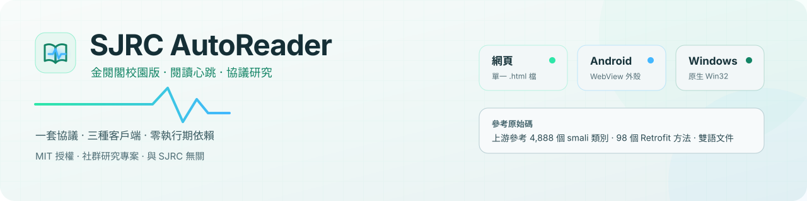
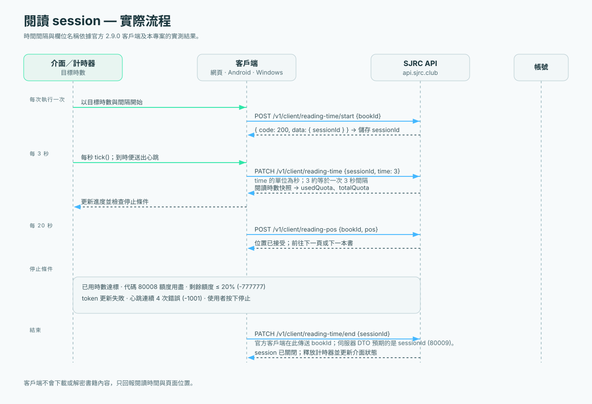

<div align="center">



# SJRC AutoReader

**金閱閣校園版（SJRC 2.9.0）的協議忠實閱讀時數客戶端**

同一套行為契約、三個獨立成品。網頁套件附本機啟動器（需 Python 3）；端點與行為文件依據公開的
2.9.0 客戶端資料整理；儲存庫不散布完整反編譯來源樹。

<br>


[English](README.en.md) · **繁體中文**

[下載](#-下載) · [運作方式](#-運作方式) · [文件](#-文件) · [建置](#-從源碼建置) · [常見問題](#-常見問題) · [貢獻](#-貢獻)

</div>

---

> [!WARNING]
> **僅供研究與個人學習。** 以自動化方式累積閱讀時數可能違反平台服務條款、學校
> 規定或兩者。帳號可能被限制或停權。本專案與 SJRC 無任何關聯，未獲授權或背書。
> 執行前請讀[法律與可接受使用](docs/zh/legal.md)。後果由使用者自負。

> [!NOTE]
> 這是**客戶端互通性專案**，不是書籍下載器。它只向 API 回報閱讀時間與頁面位置。
> 它**不會**下載書籍、請求 DRM 金鑰、解密內容、收集憑證，也不營運後端。反編譯
> 源碼描述了內容保護層，但不附帶任何金鑰素材。

---

## 📥 下載

每個平台提供完整 ZIP 套件，下載後先解壓縮。網頁套件包含 HTML、本機伺服器與
Windows 啟動 `.bat`；Android 與 Windows 套件則包含應用程式、說明、授權及校驗碼。

<table>
<tr>
<td align="center" width="33%">

### 🌐 網頁

[**下載網頁套件**](https://github.com/infycat/SJRC-AutoReader/releases/latest/download/SJRC-AutoReader-Web.zip)

<sub>HTML · 啟動 `.bat` · 本機伺服器 · 說明 · SHA256SUMS</sub>

</td>
<td align="center" width="33%">

### 📱 手機

[**下載 Android 套件**](https://github.com/infycat/SJRC-AutoReader/releases/latest/download/SJRC-AutoReader-Android.zip)

<sub>APK · 安裝說明 · 授權 · SHA256SUMS</sub>

</td>
<td align="center" width="33%">

### 💻 電腦

[**下載 Windows 套件**](https://github.com/infycat/SJRC-AutoReader/releases/latest/download/SJRC-AutoReader-Windows.zip)

<sub>EXE · 使用說明 · 授權 · SHA256SUMS</sub>

</td>
</tr>
</table>

每個 ZIP 旁都有 `.zip.sha256` 可驗證套件；解壓後，套件內的 `SHA256SUMS` 可驗證
其中所有檔案。網頁套件在 Windows 上雙擊 `Start-SJRC-AutoReader.bat` 即可啟動。

驗證下載套件（以網頁版為例）：

```bash
sha256sum -c SJRC-AutoReader-Web.zip.sha256  # Linux
shasum -a 256 -c SJRC-AutoReader-Web.zip.sha256  # macOS
```

Windows：`certutil -hashfile SJRC-AutoReader-Web.zip SHA256`，再與 sidecar 內的值比較。

若雜湊不符，請停止並不要執行。各平台的解壓、安裝與卸載步驟見
[安裝](docs/zh/installation.md#驗證下載)。

---

## ⚡ 快速開始

### 網頁 · 最容易稽核

```bash
# 下載並解壓網頁套件後，Windows 雙擊 Start-SJRC-AutoReader.bat
# macOS/Linux 在套件資料夾執行：python3 serve_web.py
```

頁面必須用 HTTP 提供。`file://` 的 origin 是 `null`，會讓 Google Identity
Services 失敗。用 Google 登入，確認模擬模式沒勾，按**開始**。瀏覽器分頁必須
保持開啟。

**Google origin：** 在
[Google Cloud Console](https://console.cloud.google.com/apis/credentials) →
你的 OAuth client → **已授權的 JavaScript 來源** 加入
`http://localhost:8080`。scheme、host、port 與「結尾不能有斜線」都有影響。

### Android · 手機

1. 把 `phone/SJRC-AutoRead.apk` 複製到裝置。
2. 允許檔案管理器「安裝未知應用程式」。
3. 安裝、開啟，用**電郵 + 密碼**登入。
4. 按**開始**，盡量讓 App 保持在前景。

外殼套件是 `club.sjrc.autoread`（`minSdk 23`、`targetSdk 33`），不是官方
`club.sjrc.app`。Google 登入刻意不提供：Google 封鎖嵌入式 WebView 的 OAuth。
見 [Android 安裝](docs/zh/installation.md#android)。

### Windows · 原生

雙擊 `pc/SJRC_AutoReader.exe`。它沒有簽章，SmartScreen 可能警告；先驗證雜湊，
再選**仍要執行**。

登入方式：開臨時本機 Google 輔助頁，或貼上從瀏覽器工作階段複製的 access
token。設定與 token 存在 `HKCU\Software\SJRC\AutoReader`。見
[Windows 安裝](docs/zh/installation.md#windows)。

### 登入方式對照

| 方式 | 網頁 | 手機 | 電腦 |
|---|:---:|:---:|:---:|
| Google 帳號 | ✅ | ❌ | ✅ 本機登入頁 |
| 電郵 + 密碼 | ❌ | ✅ | ❌ |
| 驗證碼二次驗證 | ✅ | ✅ | ✅ |
| 貼上 access token | ❌ | ❌ | ✅ |

網頁版只用 Google；Android 外殼只用電郵密碼；Windows 支援本機 Google 輔助頁
與手動 token。三者都會在伺服器回 `ticket` 時走驗證碼流程。若帳號沒有密碼，
請先在原版 App 設定：**我的 → 密碼 → 修改**。

---

## ✨ 它做什麼

| | 行為 | 細節 |
|---|---|---|
| 💓 | **3 秒心跳** | 對齊官方客戶端：`setCountDownInterval(3000)`，`time: 3`（**秒**） |
| 📖 | **閱讀 session** | `start` 建立 `sessionId`；每次心跳與最後的 `end` 都用它 |
| 📄 | **翻頁** | 預設 20 秒；每次翻頁送 `POST /v1/client/reading-pos` |
| 📚 | **自動換書** | 讀完一本，從書架／首頁隨機選下一本 |
| 🎯 | **目標停止** | 累積時間達到設定時數就停 |
| 🛑 | **安全停止** | 手動停止、額度用完（`80008`）、剩餘 ≤20%（`-777777`）、連續四次心跳失敗（`-1001`） |
| 🧹 | **Session 清理** | 停止／關閉時送 `PATCH /reading-time/end {sessionId}` |
| 🔐 | **憑證留在本機** | Token 存在瀏覽器儲存、WebView 儲存或目前使用者的登錄檔 |
| 📦 | **零依賴** | Vanilla JS、WebView 外殼、靜態連結 C++ |
| 🧪 | **模擬模式** | 只跑 UI 與計數，不發任何請求 |

### 它明確不做的事

- ❌ 下載書籍檔案、圖片或 EPUB 內容
- ❌ 請求 `booksKey`、解密 DRM 或保存金鑰素材
- ❌ 使用後端、代理、中繼、分析 SDK 或當機回報
- ❌ 繞過認證、額度或帳號限制
- ❌ 保證學校允許自動化

---

## 🔁 運作方式

三個客戶端沒有共用程式碼，但實作同一套觀察到的契約。完整流程見
[架構](docs/zh/architecture.md#session-狀態機) 與 [API 參考](docs/zh/api.md)。



```text
登入 ──► accessToken（+ refreshToken）
           │
           ▼
POST /v1/client/reading-time/start { bookId } ──► { sessionId, totalQuota, usedQuota }
           │
           ├── 每 3 秒：  PATCH /v1/client/reading-time { sessionId, time: 3 }
           ├── 每 20 秒： POST  /v1/client/reading-pos  { bookId, pos }
           └── 停止時：   PATCH /v1/client/reading-time/end { sessionId }
```

容易弄錯、而本儲存庫明確記錄的點：

| 陷阱 | 正確做法 |
|---|---|
| `time` 送毫秒 | 送**秒**。`3` 是三秒；`28800` 額度是 8 小時。 |
| `end` 送 `bookId` | 送 **`sessionId`**。官方客戶端送 `bookId`，得到 `80009`。 |
| 漏掉 `x-auth-schema` | 已認證路由送 `CLIENT`，登入／續期送 `PUBLIC`。 |
| 每個請求都掛 Bearer | 只在 `CLIENT` 且 token 非空時掛。 |
| 只用驗證碼 | 驗證碼需要 `pre-login` 的 `ticket`；ticket 是一次性的。 |
| 在 Android WebView 內用 Google | Google 封鎖（`disallowed_useragent`）；請用電郵密碼。 |

共用標頭是 `version: 2.9.0`、`x-current-platform: android`、
`x-current-locale: zh-HK`、`x-auth-schema` 與 `authorization`。API base 是
`https://api.sjrc.club/`；成功是 `code == 200 || code == 201`，不是只看 HTTP 200。

---

## 🗂 儲存庫結構

```text
SJRC-AutoReader-Repo/
├── web/
│   ├── SJRC_AutoReader.html      # 完整單檔網頁應用
│   └── src/README.md             # 結構導覽
├── phone/
│   ├── SJRC_AutoRead.apk         # 已簽章 WebView 外殼（club.sjrc.autoread）
│   └── src/
│       ├── AndroidManifest.xml
│       ├── index.html            # 內嵌頁：電郵密碼 + __appPause
│       ├── *.smali               # 6 個官方客戶端協議節錄
│       └── README.md
├── pc/
│   ├── SJRC_AutoReader.exe       # 原生 Win32/WinHTTP，靜態連結
│   └── src/
│       ├── main.cpp              # 整個 Windows 客戶端
│       ├── build.bat · app.rc · app.ico
│       └── README.md
├── data/                         # 乾淨端點表與源碼統計
├── examples/                     # .http 請求範例（不含憑證）
├── docs/
│   ├── en/ · zh/                 # 17 篇雙語文件
│   ├── assets/                   # 橫幅、標誌、架構圖
│   └── screenshots/
├── scripts/                      # 檢查器、打包器、本機伺服器
├── .github/                      # CI、發行流程、issue 表單
├── CODE-OVERVIEW.md              # 單一文件的專案總結
├── README.md · README.zh.md
├── CONTRIBUTING.md · SECURITY.md · SUPPORT.md · GOVERNANCE.md
├── CODE_OF_CONDUCT.md · CHANGELOG.md · ROADMAP.md
├── AUTHORS.md · NOTICE.md · CITATION.cff
└── LICENSE                        # MIT，僅涵蓋原創部分
```

任務導向的「我想改 X」索引在[程式碼地圖](docs/zh/code-map.md)。單一文件的敘事
總結是 [`CODE-OVERVIEW.md`](CODE-OVERVIEW.md)（繁體中文，附英文摘要）。

---

## 📚 文件

每一頁都有英文與繁體中文，結構相同。依你的目標選閱讀路徑。

### 執行

| # | 中文 | English | 回答什麼 |
|---|---|---|---|
| 1 | [快速開始](docs/zh/getting-started.md) | [Getting started](docs/en/getting-started.md) | 是否安全？五分鐘首次執行 |
| 2 | [安裝](docs/zh/installation.md) | [Installation](docs/en/installation.md) | 各平台安裝、校驗碼、卸載 |
| 3 | [設定](docs/zh/configuration.md) | [Configuration](docs/en/configuration.md) | 每個欄位、預設、範圍、儲存鍵 |
| 4 | [使用](docs/zh/usage.md) | [Usage](docs/en/usage.md) | 完整執行迴圈、日誌、停止條件、好習慣 |

### 理解

| # | 中文 | English | 回答什麼 |
|---|---|---|---|
| 5 | [架構](docs/zh/architecture.md) | [Architecture](docs/en/architecture.md) | 元件、狀態機、資料流、設計取捨 |
| 6 | [API 參考](docs/zh/api.md) | [API reference](docs/en/api.md) | 標頭、端點、DTO、單位、認證、錯誤碼 |
| 7 | [程式碼地圖](docs/zh/code-map.md) | [Code map](docs/en/code-map.md) | 每個行為在哪裡、逐行索引 |
| 8 | [逆向分析](docs/zh/reverse-engineering.md) | [Reverse engineering](docs/en/reverse-engineering.md) | 方法、證據、心跳狀態機、限制 |
| 9 | [名詞解釋](docs/zh/glossary.md) | [Glossary](docs/en/glossary.md) | 心跳、session、ticket、額度、smali、DTO |

### 建置、測試、發行

| # | 中文 | English | 回答什麼 |
|---|---|---|---|
| 10 | [建置](docs/zh/building.md) | [Building](docs/en/building.md) | 重建網頁、APK、EXE |
| 11 | [測試](docs/zh/testing.md) | [Testing](docs/en/testing.md) | 靜態檢查、模擬測試、手動矩陣 |
| 12 | [發行流程](docs/zh/release.md) | [Release process](docs/en/release.md) | 版本、打包、校驗碼、標籤 |

### 信任與界線

| # | 中文 | English | 回答什麼 |
|---|---|---|---|
| 13 | [安全](docs/zh/security.md) | [Security](docs/en/security.md) | 威脅模型、token 儲存、範圍 |
| 14 | [隱私](docs/zh/privacy.md) | [Privacy](docs/en/privacy.md) | 什麼離開裝置、什麼被保存 |
| 15 | [法律](docs/zh/legal.md) | [Legal](docs/en/legal.md) | 授權範圍、免責、可接受使用 |

### 協助與參考

| # | 中文 | English | 回答什麼 |
|---|---|---|---|
| 16 | [疑難排解](docs/zh/troubleshooting.md) | [Troubleshooting](docs/en/troubleshooting.md) | 症狀 → 原因 → 修法，含確切代碼 |
| 17 | [常見問題](docs/zh/faq.md) | [FAQ](docs/en/faq.md) | 最常被問的問題 |
| — | [文件索引](docs/README.md) | [Documentation index](docs/README.md) | 所有頁面、閱讀路徑、慣例 |

其他機器可讀素材：

- [`data/api-endpoints.csv`](data/api-endpoints.csv) · [JSON](data/api-endpoints.json) —— 98 個方法、67 個唯一 `METHOD + path`
- [`data/api-endpoints-by-module.md`](data/api-endpoints-by-module.md) —— 依類別分組
- [`data/source-stats.json`](data/source-stats.json) —— SDK 等級、類別數、成品雜湊
- [`SHA256SUMS`](SHA256SUMS) —— 下載完整性

---

## 🧱 從源碼建置

出貨二進位就是成品。重建是選項，各平台做法見[建置](docs/zh/building.md)。

### 網頁

沒有建置步驟。HTML **就是**源碼。用 Node 18+ 檢查行內 script：

```bash
python3 - <<'PY'
import re, pathlib
html = pathlib.Path('web/SJRC_AutoReader.html').read_text()
pathlib.Path('.web-check.js').write_text(re.findall(r'<script>(.*?)</script>', html, re.S)[-1])
PY
node --check .web-check.js && rm .web-check.js
```

### Android 外殼

簽入的 APK 已簽章。要修補內嵌頁面：

```bash
apktool d phone/SJRC_AutoRead.apk -o build/phone
# 編輯 build/phone/assets/index.html
apktool b build/phone -o build/SJRC-AutoRead-unsigned.apk
apksigner sign --ks my-release.jks --out build/SJRC-AutoRead.apk \
  build/SJRC-AutoRead-unsigned.apk
```

最小 Gradle 流程與無 SDK 的 smali 流程見
[建置](docs/zh/building.md#android-外殼)。activity 必須用完整類名，且要保留
file URL 的 WebView 旗標，否則外殼只會顯示空白。

### Windows

```bat
cd pc\src
build.bat
```

等價於：

```bat
windres app.rc -O coff -o app.res.o
g++ -O2 -std=c++17 -municode main.cpp app.res.o ^
    -o SJRC_AutoReader.exe ^
    -static -static-libgcc -static-libstdc++ ^
    -lwinhttp -lcomctl32 -lws2_32 -lole32 -luser32 -lgdi32 -lshell32
```

`-static` 很重要：沒有它，執行檔會需要 MinGW runtime DLL。

### 儲存庫檢查

```bash
make check        # 連結、文件對齊、JSON/CSV、雜湊、SVG/XML、秘密外洩
make serve        # 在 http://localhost:8080 提供網頁版
make package      # 可重現的 SJRC-AutoReader-Repo.zip + SHA256
```

檢查器離線執行，不連 SJRC API。CI 在每個 push 與 pull request 跑同一組檢查；
見 [`.github/workflows/ci.yml`](.github/workflows/ci.yml)。

---

## 🔐 安全與隱私

| 問題 | 答案 |
|---|---|
| 有專案後端嗎？ | 沒有。客戶端直接連 `api.sjrc.club`。 |
| Token 存在哪？ | 網頁：`localStorage`；Android：WebView 儲存；Windows：`HKCU\Software\SJRC\AutoReader`。 |
| 有遙測嗎？ | 沒有。沒有分析、當機回報或遠端日誌。 |
| 會存密碼嗎？ | 不會。只用於一次登入請求，之後丟棄。 |
| 含書籍內容或 DRM 金鑰嗎？ | 沒有。內容層只作研究描述；硬編碼金鑰已替換為佔位符。 |
| 主要風險是什麼？ | 平台條款、帳號限制、裝置被入侵，以及來自非官方鏡像的未簽章二進位。 |

完整威脅模型見[安全](docs/zh/security.md)；資料清單與保留表見
[隱私](docs/zh/privacy.md)。安全性問題請依 [SECURITY.md](SECURITY.md) 私下回報。
不要在 issue 貼 token、密碼、驗證碼、電郵、校名或書名。

---

## ⚠️ 已知限制

- **快照，不是穩定 API。** 協議還原自 SJRC 2.9.0。未來版本可能改標頭、單位或路由。
- **網頁只有 Google。** 單檔網頁沒有電郵密碼表單；那條路徑在 Android 資產裡。
- **Android 對前景敏感。** 系統可能節流背景 timer；外殼在 `onStop` 會暫停迴圈。
- **Windows 沒有簽章。** SmartScreen 可能警告。在意的人請驗證雜湊或從源碼重建。
- **Android 外殼源碼不完整。** APK 內有六個類別，原始碼樹只有 manifest 與
  `MainActivity` 節錄。完整外殼請反組譯 `classes.dex`。
- **CI 不測真實 API。** 只檢查靜態性質，無法偵測伺服器端協議變更。

---

## ❓ 常見問題

<details>
<summary><b>為什麼網頁版沒有電郵密碼登入？</b></summary>

<br>

出貨的網頁用 Google Identity Services。電郵密碼流程實作在 Android 資產
（`phone/src/index.html`），因為外殼不能用 Google。要加進網頁是程式改動，不是
文件改動；見[程式碼地圖](docs/zh/code-map.md#網頁版)。

</details>

<details>
<summary><b>為什麼心跳是 3 秒？</b></summary>

<br>

官方 2.9.0 客戶端就是這樣：3000 ms 倒數間隔，`time` 送 3 **秒**。這不是本專案
的偏好。更快的間隔不會生出額度，只會增加錯誤機會。見
[逆向分析](docs/zh/reverse-engineering.md#心跳狀態機)。

</details>

<details>
<summary><b>Android 上 Google 說 <code>disallowed_useragent</code></b></summary>

<br>

Google 封鎖嵌入式 WebView 的 OAuth。請用電郵密碼表單。若帳號沒有密碼，請在
官方 SJRC App 設定。不要嘗試把 Google Identity Services 載進外殼；它刻意不支援。

</details>

<details>
<summary><b><code>end</code> 回 <code>80009</code></b></summary>

<br>

`80009` 表示伺服器找不到閱讀 session。最常見原因是送 `bookId` 而不是
`sessionId`。官方客戶端有這個 bug；本專案沒有照抄。見
[疑難排解](docs/zh/troubleshooting.md#end-回-80009)。

</details>

<details>
<summary><b>我的帳號安全嗎？</b></summary>

<br>

本專案不營運伺服器，也不會把憑證送到 SJRC API 以外的地方。主要風險是平台政策、
帳號限制與你自己的裝置安全。請用你能控制的裝置、驗證二進位雜湊，並在大量使用前
讀[法律](docs/zh/legal.md)。

</details>

更多答案：[常見問題](docs/zh/faq.md)。

---

## 🤝 貢獻

只要尊重專案界線，貢獻都歡迎。

- 先讀 [CONTRIBUTING.md](CONTRIBUTING.md) 與[行為準則](CODE_OF_CONDUCT.md)。
- 用 issue 表單回報 bug 或功能；附上成品、作業系統、確切錯誤碼與去識別化日誌。
- 英文與中文文件要保持結構對齊；`make check` 會檢查連結、對齊、資料一致性、
  校驗碼與意外外洩的秘密。
- 協議改動必須引用確切 smali 類別或公開 Swagger 操作。不要加入 DRM 規避、
  憑證收集，或會接收使用者 token 的後端。
- 安全性問題走 [SECURITY.md](SECURITY.md)，不要開公開 issue。

專案角色、決策方式與發行權限見 [GOVERNANCE.md](GOVERNANCE.md)。支援期望見
[SUPPORT.md](SUPPORT.md)。計畫中的工作見 [ROADMAP.md](ROADMAP.md)。

---

## 📜 授權與署名

原創程式碼與文件以 [MIT License](LICENSE) 釋出。SJRC 名稱、反編譯客戶端素材、
第三方程式碼與任何書籍內容仍屬各自權利人，**不在** MIT 授權範圍內。完整範圍與
移除流程見 [NOTICE.md](NOTICE.md)。

若在研究中引用本作品，請用 [CITATION.cff](CITATION.cff)。貢獻者列於
[AUTHORS.md](AUTHORS.md)。

<div align="center">

<sub>為協議研究而建，不是為了繞過平台。</sub>

<sub>⭐ 若這個儲存庫幫你理解了協議，歡迎加星 —— 這會讓稽核線索更容易被找到。</sub>

</div>
