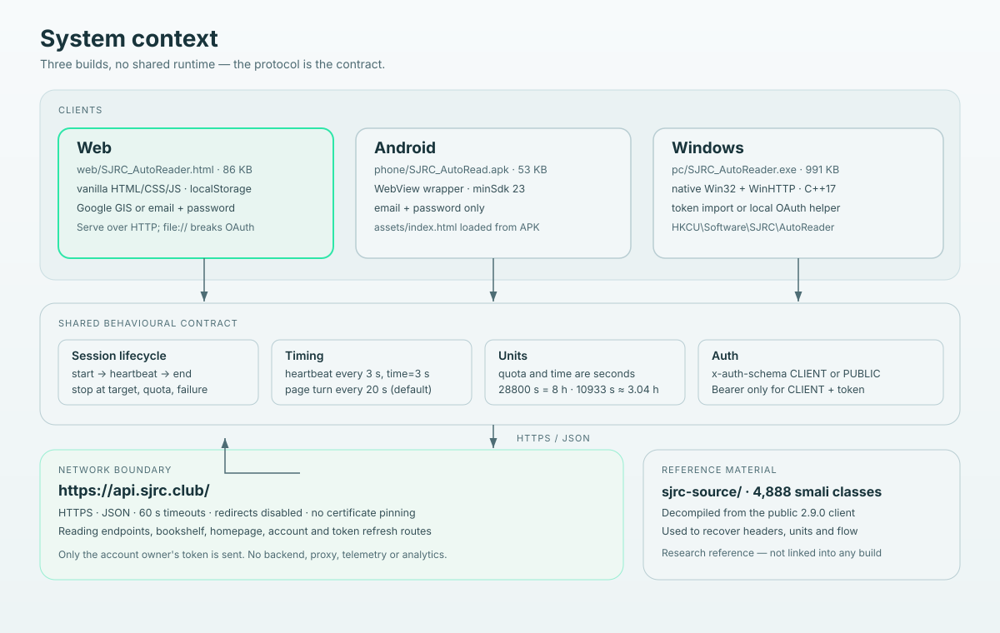

# Architecture

[中文](../zh/architecture.md) · English



## System context

```text
┌──────────────────────┐   ┌──────────────────────┐   ┌──────────────────────┐
│ Web                  │   │ Android wrapper      │   │ Windows native       │
│ single HTML          │   │ WebView + asset      │   │ Win32 + WinHTTP      │
│ vanilla JS           │   │ email login only     │   │ local OAuth helper   │
└──────────┬───────────┘   └──────────┬───────────┘   └──────────┬───────────┘
           │                          │                          │
           └──────────────────────────┼──────────────────────────┘
                                      │ HTTPS, same headers
                                      ▼
                         https://api.sjrc.club/
                         reading-time · reading-pos · books · auth
```

There is no backend in this project. Each build talks directly to the upstream
API. There is no shared library either: the three clients intentionally duplicate
the small behavioural contract so that each can be audited as a single file.

## The behavioural contract

All builds must agree on these values. If you change one, change all three and
update the docs and tests.

| Behaviour | Value | Web | Android | Windows |
|---|---|---|---|---|
| Heartbeat interval | 3 s (configurable) | `heartbeat()` at line 889 | embedded page | `workerLoop()` at `pc/src/main.cpp:806` |
| Heartbeat body | `{sessionId, time: <seconds>}` | `heartbeat()` | embedded page | `snprintf` in `workerLoop()` |
| Page turn | 20 s (configurable) | `turnPage()` at line 1024 | embedded page | `workerLoop()` |
| Position report | `POST /v1/client/reading-pos` | `sendReadPos()` at line 840 | embedded page | `sendReadPos()` at line 594 |
| Target stop | `elapsed >= target` | `updateProgress()` at line 968 | embedded page | `workerLoop()` |
| End session | `PATCH .../end {sessionId}` | `endBook()` at line 872 | `__appPause()` | `endSession()` at line 613 |
| Error threshold | 4 consecutive heartbeat failures | `onHeartbeatError()` at line 942 | embedded page | `workerLoop()` (also 3 token-refresh failures) |
| Quota warning | remaining ≤ 20% | log message | log message | log message |

The Android column says “embedded page” because the wrapper ships the same page
logic under `phone/src/index.html`; it is not a separate implementation. The
Google-only versus email-only sign-in difference is an authentication choice, not
a protocol difference.

## Web build

```text
SJRC_AutoReader.html
├── <style>    design tokens, layout, cards, log
├── <body>     login card · parameters · book · progress · account · log
└── <script>
     ├── transport     api(), refreshAccessToken(), isSucc()
     ├── auth          initGsi(), preLogin(), adoptLogin(), doLogin()
     ├── account       loadAccount()
     ├── books         collectBooks(), fetchCandidateBooks(), startBook()
     ├── session       heartbeat(), sendReadPos(), endBook()
     ├── scheduler     tick(), tickInner(), turnPage(), nextBook()
     └── lifecycle     startRun(), stopAll(), boot()
```

The single-file choice is deliberate: the product is the source. A reviewer can
open one file, search for `fetch(`, and see every network call. The cost is a
large file and no module boundaries; `web/src/README.md` provides the map.

### Concurrency model

One `setInterval(..., 1000)` drives everything. `tickBusy` prevents overlapping
ticks. Heartbeats and turns are due-time comparisons against `Date.now()`, so a
throttled tab does not emit a burst of catch-up requests. Every request has its
own `AbortController` with a 30 s timeout.

### State

`S` holds tokens, the current book/session, counters, quota, and the timer. It is
not persisted as a whole; only the token, refresh token, ticket, and current
session ID are stored individually. A page reload therefore starts a fresh run,
which is safer than resuming a stale session.

## Android build

```text
APK
├── AndroidManifest.xml       package club.sjrc.autoread, minSdk 23
├── classes.dex               6 small classes (MainActivity, OAuthClient, …)
├── assets/index.html         the same UI, email login only
└── res/mipmap/ic_launcher.png
```

`MainActivity` creates a `WebView`, enables file-URL access, and loads
`file:///android_asset/index.html`. The two flags
(`setAllowFileAccessFromFileURLs`, `setAllowUniversalAccessFromFileURLs`) are
mandatory: without them the `file://` page cannot call `https://api.sjrc.club`.
`onStop()` calls the page's `__appPause()` to stop the loop and request an end.

The APK is signed with V1+V2+V3. It is a different package from the official app
and can coexist with it.

## Windows build

```text
main.cpp
├── utility      UTF-8/UTF-16, formatting, time
├── JSON         JVal / JParser (no external library)
├── HTTP         WinHTTP wrapper (httpCall)
├── business     quota, book selection, session, workerLoop
├── UI           Win32 controls, GDI+ painting, timers
└── auth server  loopback HTTP listener for the local sign-in page
```

`workerLoop()` runs on a `std::thread`. Shared state (`g_snap`) is guarded by
`g_mtx`; the UI thread reads a snapshot and repaints. `WM_CLOSE` sets `g_stop`,
joins the worker, and lets the worker call `endSession()`.

WinHTTP is configured with `followRedirects=false` so a redirect cannot carry the
Bearer token to another host. The executable is statically linked (`-static`) so
it has no DLL dependencies.

## Session state machine


```text
IDLE
 │ start clicked, target/license checks pass
 ▼
STARTING ── POST /reading-time/start ──► RUNNING (sessionId)
                                           │
        ┌──────────────────────────────────┤
        │ every hbSec                      │ every turnSec
        ▼                                  ▼
 PATCH /reading-time              POST /reading-pos
 {sessionId, time}                 advance page
        │                                  │
        ├─ 10117/10119 → refresh → retry   ├─ last page → end + next book
        ├─ quota exhausted → ENDING        │
        └─ 4 failures → ENDING             │
                                           │
 target reached ───────────────────────────┘
        ▼
ENDING ── PATCH /reading-time/end {sessionId} ──► IDLE
```

The refresh path is careful: a 10117/10119 response triggers one refresh, and the
failed request is **not** counted as a heartbeat failure. Only non-auth failures
increment `errorTime`. This mirrors the official client's retry interceptor.

## Quota logic

`totalQuota`, `usedQuota`, and `time` are seconds. The official predicates are:

```kotlin
isUserQuotaValid()       = totalQuota >= usedQuota
isRemainTimeLessThan20() = (totalQuota - usedQuota) <= totalQuota * 0.2f
```

The second is a ratio, not 20 minutes. The project logs a warning at that point
but does not necessarily stop; `usedQuota > totalQuota` is the hard stop.

## Data flow


```text
credentials ──► accessToken ──► GET reading-time (baseline)
                                     │
                                     ▼
                          POST reading-time/start {bookId}
                                     │ sessionId
                                     ▼
        ┌──────────── heartbeat loop ────────────┐
        │ PATCH reading-time {sessionId,time:3}  │
        │ response includes quota fields         │
        └────────────────────────────────────────┘
                                     │
                          page turn / reading-pos
                                     │
                          book done ─┴─► random next book
                                     │
                          stop ──────┴─► PATCH end {sessionId}
```

## Design decisions

| Decision | Why | Trade-off |
|---|---|---|
| No build step for web | Auditable, portable, no supply chain | Large single file, no modules |
| No third-party client libraries | Small apps without a package manager | Web download launcher uses Python 3 to provide the required local HTTP origin |
| Three independent clients | Each platform uses its natural primitives | Behaviour can drift; contract table and tests mitigate |
| Tokens in local storage / registry | Simple, no extra key management | Anyone with device/profile access can read them |
| No certificate pinning | Avoid breaking on upstream certificate rotation | Weaker against a local MITM; relies on TLS verification |
| End sends `sessionId` | The official `bookId` variant returns 80009 | Diverges from the captured client, matches the server |
| Demo mode | Lets users see the loop without sending requests | Does not validate the live protocol |

## Failure handling

| Failure | Behaviour |
|---|---|
| Network timeout | Web aborts after 30 s; Windows phase timeout; error counted |
| 401 / 10117 / 10119 | Refresh once, retry on the next tick; do not count as error |
| Refresh fails | Stop and ask for a new sign-in |
| 10102 | Log a unit/session hint; count as error; stop after 4 |
| 80008 | Stop immediately |
| 80009 on end | Log; clear local session anyway |
| Book detail fails | Do not start; pick another book or stop |
| Empty shelf/homepage | Stop with a clear message |
| App/tab closed | No cleanup; server session expires |

## Testability boundaries

| Unit | Pure? | How to test |
|---|---|---|
| `fmtHours`, `fmtHMS` | yes | table tests |
| `collectBooks`, `flattenChapters` | yes | fixture JSON |
| `api()` header construction | mostly | mock `fetch` |
| `sendReadPos` body | yes | assert shape and rounding |
| `tickInner` scheduling | with fake clock | inject `now` |
| `workerLoop` | no | extract helpers or integration test with a mock server |
| WebView shell | no | instrumented Android test |

The repository's `scripts/check_repo.py` covers static and structural checks; it
does not exercise the live API.

## Known weaknesses

- No automated protocol test against a mock server yet.
- The web UI has no accessibility audit; focus order and contrast need work.
- Windows UI strings are Traditional Chinese only.
- A long run in a background browser tab will be throttled.
- The Android wrapper source is not complete in the tree; the APK is the artifact.
