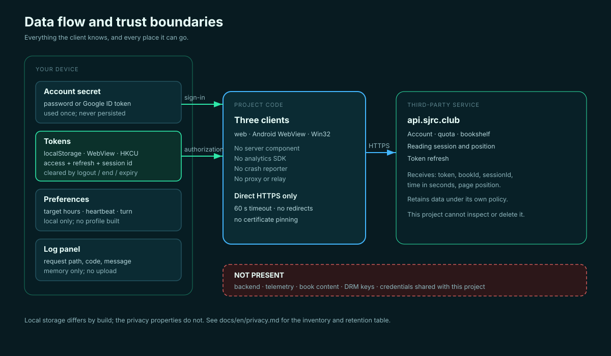

# Privacy

[中文](../zh/privacy.md) · English

## Short version

This project has no backend, no telemetry, and no analytics. It processes your
SJRC account data locally and sends only the requests needed to maintain a
reading session to `api.sjrc.club`. Google sign-in additionally contacts Google.



## Data inventory

| Data | Source | Purpose | Stored where | Retention |
|---|---|---|---|---|
| Email / password | You | Sign in | Not stored | Request only |
| Google ID token | Google Identity Services | Sign in | Memory | Sign-in flow |
| Access token | API | Authenticate requests | localStorage / registry | Until logout or overwrite |
| Refresh token | API | Renew access | localStorage / registry | Until logout or overwrite |
| Verification ticket | API | Complete 2FA | sessionStorage / memory | One exchange / tab close |
| Name, email, school, role | API | Display account card | Memory/UI | Session |
| Total/used quota | API | Progress | Memory; session ID persisted | Session |
| Reading position | Estimated locally, sent to API | Report progress | Memory | Session |
| Book title/author | API | Display | Memory | Session |
| Logs | Generated locally | Diagnostics | DOM / edit control | Until cleared / app closes |

No data is written to a file by the app. No data is sent anywhere except the API
hosts listed below.

## Network destinations

| Destination | When | Data sent |
|---|---|---|
| `https://api.sjrc.club/` | All app operations | Headers, credentials, session ID, reading time/position, book IDs |
| `https://accounts.google.com/` | Google sign-in (web/helper) | Google OAuth flow |
| `https://www.gstatic.com/` | Loading Google Identity Services | Standard web request metadata |

No advertising, analytics, crash-reporting, or update-check endpoint is used.

## Cookies and browser storage

The web app does not set cookies. It uses `localStorage` for four keys and
`sessionStorage` for the ticket. The Google GIS script may set its own cookies or
storage under Google's policies; that is outside this project's control.

## Windows registry

Settings and tokens are stored under `HKCU\Software\SJRC\AutoReader` as plain
strings. Anyone who can read your Windows profile can read them. Remove with:

```bat
reg delete "HKCU\Software\SJRC\AutoReader" /f
```

## Upstream and third parties

SJRC (the service operator) receives the requests and may log them according to
its own policies. Google receives the OAuth flow if you use Google sign-in. This
project has no agreement with either party and cannot delete data they hold.

## Your controls

- Log out to remove tokens from the app's storage.
- Clear site data for `localhost:8080` to remove web storage.
- Delete the registry key to remove Windows settings.
- Uninstall the Android app to remove WebView storage.
- Do not use Google sign-in if you do not want Google involved. The Android
  wrapper uses email/password sign-in; the other builds do not offer it.

## Logs and screenshots

Logs can contain book titles, session IDs, and error messages. They do not
intentionally contain tokens. Before sharing:

- Redact `Bearer …`, `eyJ…`, ticket values, session IDs, emails, school names,
  and book titles.
- Crop the account card.
- Do not share a screenshot of the token field.

## Children and institutional use

The project is not directed at children. If you use it in a school, the school's
policies and the platform's terms apply. The maintainers cannot determine whether
your use is permitted.

## Changes

If a future version adds any collection, this page must be updated before the
change ships. A pull request that adds telemetry without updating this page
should be rejected.
