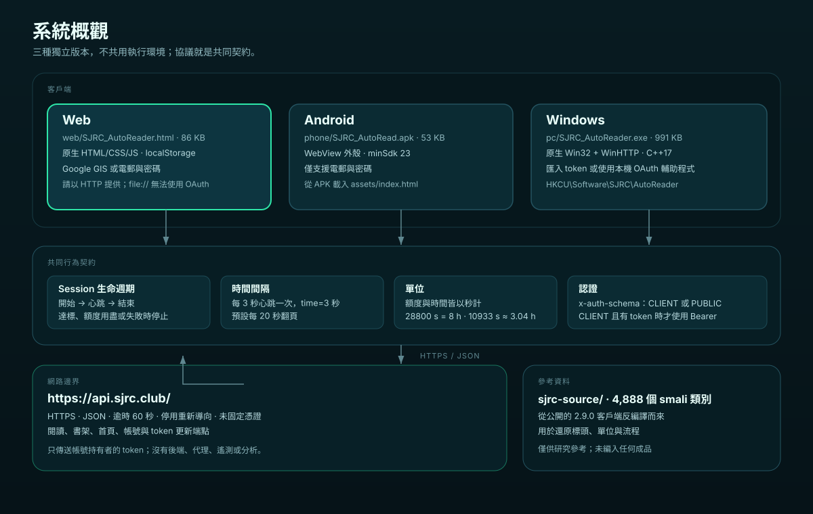
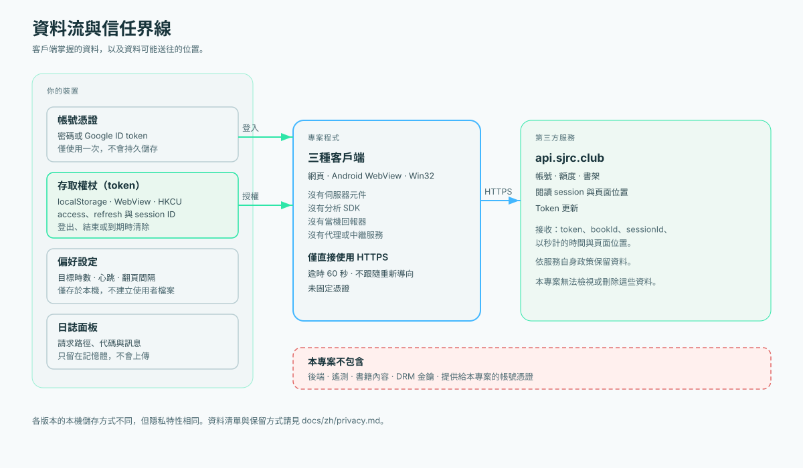

# 架構

**繁體中文** · [English](../en/architecture.md)



## 系統脈絡

```text
┌──────────────────────┐   ┌──────────────────────┐   ┌──────────────────────┐
│ 網頁                 │   │ Android 外殼          │   │ Windows 原生         │
│ 單一 HTML            │   │ WebView + asset      │   │ Win32 + WinHTTP      │
│ vanilla JS           │   │ 僅電郵登入            │   │ 本機 OAuth 登入頁     │
└──────────┬───────────┘   └──────────┬───────────┘   └──────────┬───────────┘
           │                          │                          │
           └──────────────────────────┼──────────────────────────┘
                                      │ HTTPS，相同標頭
                                      ▼
                         https://api.sjrc.club/
                         reading-time · reading-pos · books · auth
```

本專案沒有後端。每個成品直接連上游 API。三個客戶端也**不共用函式庫**，而是刻意
重複這套很小的行為契約，讓每個成品都能以單一檔案審核。

## 行為契約

所有成品必須一致。改一個就要改三個，並更新文件與測試。

| 行為 | 值 | 網頁 | Android | Windows |
|---|---|---|---|---|
| 心跳間隔 | 3 秒（可調） | `heartbeat()`，第 889 行 | 內嵌頁面 | `workerLoop()`，`pc/src/main.cpp:806` |
| 心跳 body | `{sessionId, time: <秒>}` | `heartbeat()` | 內嵌頁面 | `workerLoop()` 的 `snprintf` |
| 翻頁 | 20 秒（可調） | `turnPage()`，第 1024 行 | 內嵌頁面 | `workerLoop()` |
| 位置回報 | `POST /v1/client/reading-pos` | `sendReadPos()`，第 840 行 | 內嵌頁面 | `sendReadPos()`，第 594 行 |
| 目標停止 | `elapsed >= target` | `updateProgress()`，第 968 行 | 內嵌頁面 | `workerLoop()` |
| 結束 session | `PATCH .../end {sessionId}` | `endBook()`，第 872 行 | `__appPause()` | `endSession()`，第 613 行 |
| 錯誤上限 | 連續 4 次心跳失敗 | `onHeartbeatError()`，第 942 行 | 內嵌頁面 | `workerLoop()`（另有 3 次續期失敗） |
| 配額警告 | 剩餘 ≤ 20% | 日誌訊息 | 日誌訊息 | 日誌訊息 |

Android 欄寫「內嵌頁面」，因為外殼在 `phone/src/index.html` 承載同一套頁面邏輯，
不是另一份實作。Google-only 與 email-only 的差異是登入方式選擇，不是協議差異。

## 網頁版

```text
SJRC_AutoReader.html
├── <style>    設計 token、版面、卡片、日誌
├── <body>     登入卡 · 參數 · 書本 · 進度 · 帳號 · 日誌
└── <script>
     ├── transport     api()、refreshAccessToken()、isSucc()
     ├── auth          initGsi()、preLogin()、adoptLogin()、doLogin()
     ├── account       loadAccount()
     ├── books         collectBooks()、fetchCandidateBooks()、startBook()
     ├── session       heartbeat()、sendReadPos()、endBook()
     ├── scheduler     tick()、tickInner()、turnPage()、nextBook()
     └── lifecycle     startRun()、stopAll()、boot()
```

單檔是刻意的：**成品就是原始碼**。審查者開一個檔案、搜尋 `fetch(`，就能看到
所有網路呼叫。代價是檔案大、沒有模組邊界；`web/src/README.md` 提供地圖。

### 併發模型

只有一個 `setInterval(..., 1000)` 驅動一切。`tickBusy` 防止 tick 重疊。心跳與
翻頁都是與 `Date.now()` 比較到期時間，所以被節流的分頁不會一次補發大量請求。
每個請求有自己的 `AbortController`，30 秒 timeout。

### 狀態

`S` 持有 token、目前書本／session、計數、配額與 timer。它不會整體持久化；只分別
儲存 token、refresh token、ticket 與目前 session ID。因此重新載入頁面會開始新的
執行，比續接殘留 session 安全。

## Android 外殼

```text
APK
├── AndroidManifest.xml       package club.sjrc.autoread，minSdk 23
├── classes.dex               6 個小類別（MainActivity、OAuthClient…）
├── assets/index.html         同一份 UI，僅電郵登入
└── res/mipmap/ic_launcher.png
```

`MainActivity` 建立 `WebView`、啟用 file URL 存取、載入
`file:///android_asset/index.html`。兩個 flag
（`setAllowFileAccessFromFileURLs`、`setAllowUniversalAccessFromFileURLs`）是
必要的；沒有它們，`file://` 頁面不能呼叫 `https://api.sjrc.club`。`onStop()`
呼叫頁面的 `__appPause()` 停止迴圈並要求結束。

APK 以 V1+V2+V3 簽章。它與官方 App 是不同套件，可並存。

## Windows 原生版

```text
main.cpp
├── utility      UTF-8/UTF-16、格式化、時間
├── JSON         JVal / JParser（無外部函式庫）
├── HTTP         WinHTTP 包裝（httpCall）
├── business     配額、選書、session、workerLoop
├── UI           Win32 控制項、GDI+ 繪製、timer
└── auth server  本機登入頁的 loopback HTTP listener
```

`workerLoop()` 跑在 `std::thread`。共享狀態 `g_snap` 由 `g_mtx` 保護；UI 執行緒
讀快照並重繪。`WM_CLOSE` 設定 `g_stop`、等待 worker，讓 worker 呼叫
`endSession()`。

WinHTTP 設 `followRedirects=false`，避免重新導向把 Bearer token 帶到其他主機。
執行檔靜態連結（`-static`），沒有 DLL 依賴。

## Session 狀態機


```text
IDLE
 │ 按下開始、目標／授權檢查通過
 ▼
STARTING ── POST /reading-time/start ──► RUNNING（sessionId）
                                           │
        ┌──────────────────────────────────┤
        │ 每 hbSec                         │ 每 turnSec
        ▼                                  ▼
 PATCH /reading-time              POST /reading-pos
 {sessionId, time}                 前進一頁
        │                                  │
        ├─ 10117/10119 → refresh → 重試    ├─ 最後一頁 → end + 下一本
        ├─ 配額用盡 → ENDING               │
        └─ 連續 4 次失敗 → ENDING          │
                                           │
 達到目標 ─────────────────────────────────┘
        ▼
ENDING ── PATCH /reading-time/end {sessionId} ──► IDLE
```

續期路徑很小心：10117/10119 觸發一次 refresh，且該次失敗**不**计入心跳錯誤。
只有非認證失敗才增加 `errorTime`。這對齊官方客戶端的重試攔截器。

## 配額邏輯

`totalQuota`、`usedQuota`、`time` 的單位都是秒。官方判定：

```kotlin
isUserQuotaValid()       = totalQuota >= usedQuota
isRemainTimeLessThan20() = (totalQuota - usedQuota) <= totalQuota * 0.2f
```

第二個是比例，不是 20 分鐘。本專案在該點記錄警告，但不一定停止；
`usedQuota > totalQuota` 才是硬停止。

## 資料流



```text
憑證 ──► accessToken ──► GET reading-time（基準）
                                     │
                                     ▼
                          POST reading-time/start {bookId}
                                     │ sessionId
                                     ▼
        ┌──────────── 心跳迴圈 ──────────────────┐
        │ PATCH reading-time {sessionId,time:3}  │
        │ 回應包含配額欄位                        │
        └────────────────────────────────────────┘
                                     │
                          翻頁／reading-pos
                                     │
                          書本讀完 ─┴─► 隨機下一本
                                     │
                          停止 ──────┴─► PATCH end {sessionId}
```

## 設計決策

| 決策 | 原因 | 取捨 |
|---|---|---|
| 網頁不建置 | 可審核、可攜、無供應鏈 | 單檔較大、無模組 |
| 無執行期依賴 | 可離線、二進位小、無套件管理器 | 手寫 JSON/HTTP/UI |
| 三個獨立客戶端 | 各平台用最自然的原語 | 行為可能漂移；以契約表與測試緩解 |
| Token 存 localStorage／登錄檔 | 簡單、無額外金鑰管理 | 能存取裝置／profile 的人可讀 |
| 不做憑證固定 | 避免上游換憑證時壞掉 | 對本機 MITM 較弱；依賴 TLS 驗證 |
| `end` 送 `sessionId` | 官方 `bookId` 版本回 80009 | 與擷取客戶端不同，但符合伺服器 |
| 模擬模式 | 讓使用者看流程而不發包 | 不驗證真實協議 |

## 失敗處理

| 失敗 | 行為 |
|---|---|
| 網路 timeout | 網頁 30 秒 abort；Windows 分階段 timeout；計入錯誤 |
| 401 / 10117 / 10119 | 續期一次，下個 tick 重試；不計入錯誤 |
| 續期失敗 | 停止，要求重新登入 |
| 10102 | 記錄單位／session 提示；計入錯誤；4 次後停止 |
| 80008 | 立即停止 |
| end 回 80009 | 記錄；仍清除本機 session |
| 書本詳情失敗 | 不開書；換一本或停止 |
| 書架／首頁為空 | 以清楚訊息停止 |
| 關閉 App／分頁 | 無收尾；伺服器 session 自行過期 |

## 可測試邊界

| 單元 | 純函式？ | 測試方式 |
|---|---|---|
| `fmtHours`、`fmtHMS` | 是 | 表格測試 |
| `collectBooks`、`flattenChapters` | 是 | fixture JSON |
| `api()` 標頭組裝 | 大致是 | mock `fetch` |
| `sendReadPos` body | 是 | 斷言形狀與四捨五入 |
| `tickInner` 排程 | 需假時鐘 | 注入 `now` |
| `workerLoop` | 否 | 抽出輔助函式或對 mock server 做整合測試 |
| WebView 外殼 | 否 | Android instrumented test |

`scripts/check_repo.py` 涵蓋靜態與結構檢查，不會呼叫真實 API。

## 已知弱點

- 還沒有對 mock server 的自動協議測試。
- 網頁版沒有無障礙審核；焦點順序與對比度仍需改善。
- Windows UI 只有繁體中文。
- 在背景瀏覽器分頁長時間執行會被節流。
- Android 外殼原始碼在樹中不完整；APK 才是成品。
